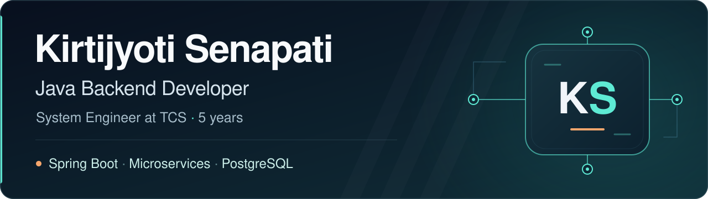

[LinkedIn](https://www.linkedin.com/in/kirtijyoti-senapati-a1a027184/) · [LeetCode](https://leetcode.com/u/Kirtijyotisenapati/) · [Repositories](https://github.com/Kirtijyoti?tab=repositories)

## Hi, I'm Kirtijyoti

I'm a **Java Backend Developer** and **System Engineer at Tata Consultancy Services**, with five years of experience developing and supporting enterprise backend applications. Based in **Bhubaneswar, India**, I work with Spring Boot, microservices, REST APIs and PostgreSQL.

My professional work includes backend features, service integrations, SQL optimization, unit testing and production troubleshooting. I also explore how AI can support application development through personal projects and learning.

### Backend engineering

| Area | Technologies and practices |
| :--- | :--- |
| Java & APIs | Java 8 / 11 / 17, Spring Boot, REST APIs, microservices |
| Persistence | SQL, PostgreSQL, Spring Data JPA, Hibernate |
| Reliability & testing | Resilience4j, JUnit, Mockito, exception handling |
| Delivery | Git, Jenkins, CI/CD, Agile / Scrum |

### Selected repositories

#### [Patient Management](https://github.com/Kirtijyoti/patient-management)

A Java/Spring Boot microservices repository organized into patient, billing, authentication and analytics services, with an API gateway. The codebase includes PostgreSQL, Kafka, gRPC/Protobuf, API request examples and a Dockerfile for the patient service.

**Stack:** Java 21 · Spring Boot 3.4 · PostgreSQL · Kafka · gRPC · Docker

#### [Java Backend Foundations](https://github.com/Kirtijyoti/java-backend-foundations)

Java practice covering object-oriented programming, polymorphism, collections and sorting. Examples include books, products and payments, alongside student lists, maps and sorting demonstrations.

**Explore:** Java fundamentals and small, focused examples.

### AI, cloud & personal exploration

- **Personal project experience:** Spring AI, Retrieval-Augmented Generation (RAG), Spring Cloud, Kafka, Redis, Docker and Kubernetes.
- **Cloud knowledge:** Amazon Web Services (AWS).
- **AI familiarity:** Agentic AI concepts, Claude for AI-assisted development and prompt engineering.

### Let's connect

I'm interested in **Java Backend** and **Spring Boot Microservices** opportunities, including roles involving **AI and RAG**.

Find me on [LinkedIn](https://www.linkedin.com/in/kirtijyoti-senapati-a1a027184/) or explore my [LeetCode profile](https://leetcode.com/u/Kirtijyotisenapati/).
