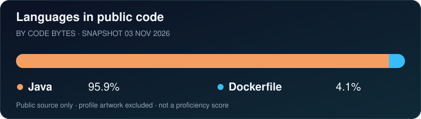

[LinkedIn](https://www.linkedin.com/in/kirtijyoti-senapati-a1a027184/) · [LeetCode](https://leetcode.com/u/Kirtijyotisenapati/)

## Java backend development, from features to production support

I'm **Kirtijyoti**, a **System Engineer at Tata Consultancy Services** with five years in Java backend development. I build and support Spring Boot services, REST APIs and database-backed applications.

My work spans feature development, service integrations, SQL optimization, unit testing and production troubleshooting. I enjoy tracing a problem across the API, service and database layers and making the fix easier to maintain.

### What I work with

| Area | Toolkit |
| :--- | :--- |
| Backend | Java 8 / 11 / 17, Spring Boot, REST APIs, microservices |
| Data | PostgreSQL, SQL, Spring Data JPA, Hibernate |
| Quality & reliability | JUnit, Mockito, Resilience4j, exception handling |
| Delivery | Git, Jenkins, CI/CD, Agile / Scrum |

### What I'm building on

- **AI application development:** personal work with Spring AI and Retrieval-Augmented Generation (RAG).
- **Cloud & distributed systems:** AWS knowledge; personal exploration of Spring Cloud, Kafka, Redis, Docker and Kubernetes.
- **Developer tools:** Claude for AI-assisted development, prompt engineering and agentic AI concepts.

### Languages in my public code

Based on GitHub's language data for my public code repositories. This measures code size, not proficiency. [Data and sources](./language-data.json).

### Connect

Based in **Bhubaneswar, India**. Interested in **Java Backend** and **Spring Boot Microservices** roles, including opportunities involving **AI and RAG**.

[Find me on LinkedIn](https://www.linkedin.com/in/kirtijyoti-senapati-a1a027184/) · [My LeetCode practice](https://leetcode.com/u/Kirtijyotisenapati/)

<!-- Counter details and language snapshot refresh notes are documented in METRICS.md. -->
